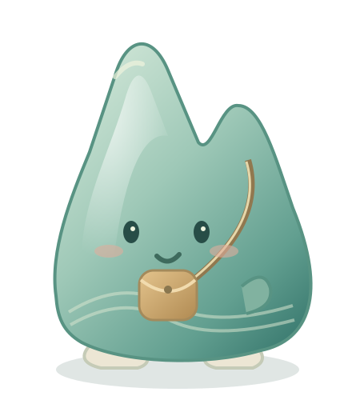

# 隐藏文创彩蛋：接入与协作说明

TripWonder 携程 · 奇境挑战。此 PR 将已试玩的单彩蛋方案接入正式探索页，保留独立 Demo 便于协作评审。

## 正式入口与边界

打开仓库 `index.html`，进入桂林并切换至遇龙河。桂林三张照片共一件“山水小旅伴”；其他目的地暂未配置彩蛋，不显示虚假的 8 城收藏进度。探索页右上方可查看 `0/1` 收藏进度，猜地点前不显示城市名称。

彩蛋是 26×30 CSS 像素的原创青瓷山形小旅伴，偶尔轻轻探头；无光圈、箭头或常驻提示。点击实际物体，确认“收进旅行收藏”后移除玩偶和点击区域，刷新后不再出现。收藏页可再次欣赏获得的数字周边。

## 代码接入

- `scene-souvenirs.js`：单一目录配置、浏览器本地收藏、挂载/清理、发现和收藏弹窗。
- `scene-souvenirs.css`：仅使用 `tw-souvenir-*` 样式，不覆盖既有页面类。
- `assets/souvenirs/guilin-passenger.svg`：原创造型源文件。
- 同目录 PNG：由 SVG 渲染的透明运行素材，兼容既有网页构建图片白名单；不修改打包脚本。
- `index.html`：两行新增资源引用。
- `app.js`：仅新增模块实例、页面销毁清理、探索页挂载三个接点。

按最新产品要求，探索页不再渲染原有讲解光标及其文字入口，地图回看只显示照片；同步调整玩法说明为观察实景。历史题目资料仍保留，供答题与来源核对。

复用现有 viewer 的 `markers/projectMarkers` 注册方式；不重写查看器，不改照片、留言、答题、计分、地图、行程、钱包或分享流程。模块离开页面时清理事件、投影标记和弹窗。收藏使用独立存储项 `tripwonder-scene-souvenirs-v1`，不改 `TWStore` 数据结构；原有“重置演示”不清除此独立收藏。存储不可用时当次仍能收藏，并明确提示无法持久保存。

以后新增目的地：在 `catalog` 增加一条记录（每个目的地只选一个 sceneId），配置当地原创周边和照片归一化坐标。其余照片不再配置彩蛋。

## 独立 Demo

直接打开 `demos/hidden-souvenir/index.html`，三张桂林实景中一枚彩蛋，可比较静态和偶尔探头。其试玩存储与正式页面分离。Demo 页面中的重置按钮仅清除 Demo 收藏。正式游戏保持原流程，不加入演示控制按钮。

## 验证

```text
node check-souvenirs.cjs
node check-clean-explore.cjs
node check-wood-notes.cjs
node demos/hidden-souvenir/check.cjs
node mobile/scripts/hosting.cjs
node --test mobile/tests/*.test.cjs
```

模块检查覆盖单彩蛋、查看器注册、拖动/双指不误触、确认后消失、再次进入不复现、存储不可用降级、事件清理及异步 ready 竞态。Demo 检查覆盖照片路径、缩小尺寸、收藏恢复等。构建同时核对网页版和移动版包含运行图片与新模块。

限制：本机应用内浏览器访问 localhost 预览超时，未完成整页真实浏览器截图与真机触摸验收。PR 保留此限制，不能把模拟页面检查当作视觉验收。玩偶预览见下图，非完整游戏截图。



## 美术与来源

原创设计采用双峰、青瓷渐变、浅金挎包、米白小脚和水纹。网络图片仅参考“山形轮廓、陶瓷釉色”的通用设计语言，没有复制或下载第三方角色和产品图。

- [YoUJ Art：陶瓷远山笔架](https://youjart.com/product/zen-ceramics-far-mountain-pen-holder-creative-pen-shelf-chinese-style-furnishings-creative-mountain-pen-holder-calligraphy-supplies/)
- [东北 Standard Market：岩木山陶瓷](https://tohokuru.jp/blogs/tohoku_column/1-ao10-08-01)

照片复用仓库现有原图且未改动：兴坪（willianjusten / Pexels）、遇龙河（yfs-visuals / Pexels）、龙脊（Kurinurm / Wikimedia Commons，CC0）。完整来源与许可见 `../../photo-library/guilin/ATTRIBUTION.md`。本周边为数字概念，不是官方授权商品，不提供实体兑换。

## 留言展示更新

保留原有任意位置选点留言及 `u/v` 坐标。每个地点用一块小木牌表示，牌上只显示图标和条数。仅将同一照片中相近的留言聚合：以照片宽度的 4.5% 为距离上限，纵向距离根据照片宽高比换算，并要求组内所有点两两接近，避免链式合并把远处地点吞进去。聚合牌锚在一条真实留言的位置，不平均或改写原数据。不同地点仍各有自己的牌。

木牌复用现有 viewer 的投影注册，随照片拖动、缩放移动。悬浮打开该处留言列表，点行才展开正文；手机点按打开。列表使用独立浮层保持在屏幕内，点击景观或 Escape 收起。点赞、筛选、自由选点及地点名称遮罩保留。选点位置不再为已移除的讲解光标让位。所有内容保存在原 `TWStore` 数据结构内，不迁移或覆盖旧留言。

`check-wood-notes.cjs` 检查相近聚合、远处分离、防止链式聚合、原坐标保留、列表限定当前地点、任意位置选点、双指不误放置，以及清理时保留彩蛋的投影记录。浏览器真实布局和触摸仍待协作者验收。