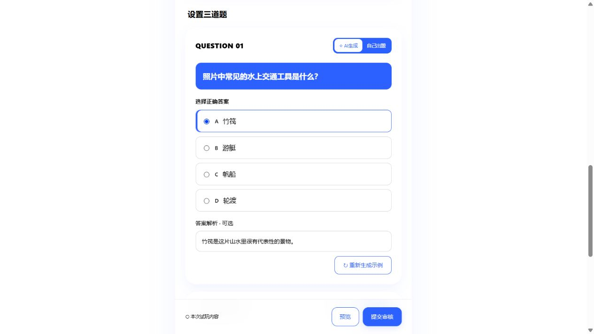

# 发布 Journey：携程三色评审 Demo

TripWonder 携程 · 奇境挑战的独立发布页视觉原型，供团队评审。未接入正式应用，也未修改现有发布、审核、定位或 AI 服务。

## 打开方式

在仓库根目录启动静态服务：

```sh
python -m http.server 8765 --bind 127.0.0.1
```

然后打开 <http://127.0.0.1:8765/demos/journey-publish/>。如端口被占用，换一个端口即可。无需安装额外依赖；需保留仓库的 `photo-library/` 目录，不能只复制本页 HTML。

## 本版设计

- UI 使用携程蓝 `#2D61FF`、白色和黑色；玻璃、高光、阴影与渐变使用这三种基础色的透明度。示例照片保留原色。
- 蓝色页头、简短说明、旅行相册和轻磨砂面板。
- `QUESTION 01–03` 使用 15px 加粗黑字；取消“题干”标签，题目蓝底白字，选项白底黑字，选中时显示蓝色边线。
- 删除“可混合使用两种方式”说明，每题依然可以独立切换 AI / 手动模式，切换不清空输入。
- 手动模式保留问题、四个选项、正确答案和可选解析，不展示对应照片选择器。
- 不展示经纬度输入框。

## 可试玩内容与边界

- 预置三张照片，第一题载入固定示例，便于直接检查题目样式；三题默认都选择 AI 模式。
- 可添加本机图片（最多 9 张）、删除图片、轮换封面、编辑文字和答案、切换题目模式、打开预览。
- “生成此题”与“重新生成示例”只填入固定示例，不会识别照片或调用 AI，重新生成会替换当前题目。
- “提交审核”仅检查照片数量、必填信息和三道题完整性，校验后显示未提交提示，不发起网络写入。
- 地点未接入搜索或定位。示例照片来自不同城市，仅用于相册和题目视觉评审，不代表可发布的同一地点 Journey。
- 编辑内容仅保留在当前页面内存中，刷新会重置；不写入正式草稿或账号数据。预览弹窗只展示封面、标题、介绍和已完成题目数量，不执行真实挑战。
- 没有加入正式页面入口；现有网页与安卓构建不收录 `demos/` 目录。请按上述本地地址查看，不能把 PR 或本地可用当作线上已发布。

## 素材来源

直接引用既有 `photo-library/` 的 `screen.webp`，不新增或修改照片文件。

| 照片 | 作者与来源 | 许可与仓库记录 |
| --- | --- | --- |
| 桂林遇龙河 | [yfs-visuals / Pexels](https://www.pexels.com/photo/19966000/) | [Pexels License](https://www.pexels.com/license/)；[原素材说明](../../photo-library/guilin/ATTRIBUTION.md) |
| 张家界云雾峰林 | [Joshua Sortino / Unsplash](https://unsplash.com/photos/aerial-view-of-mountains-gii7lF4y0WY) | [Unsplash License](https://unsplash.com/license)；[原素材说明](../../photo-library/zhangjiajie/ATTRIBUTION.md) |
| 苏州山塘街 | [Another Believer / Wikimedia Commons](https://commons.wikimedia.org/wiki/File:Shantang_Street,_Suzhou_(December_2015)_-_03.JPG) | [CC BY-SA 4.0](https://creativecommons.org/licenses/by-sa/4.0)；[原素材说明](../../photo-library/suzhou/SOURCES.md) |

航线、纸飞机和界面样式使用 HTML / SVG / CSS 绘制。未引入新字体、依赖或第三方游戏美术。

## 预览


